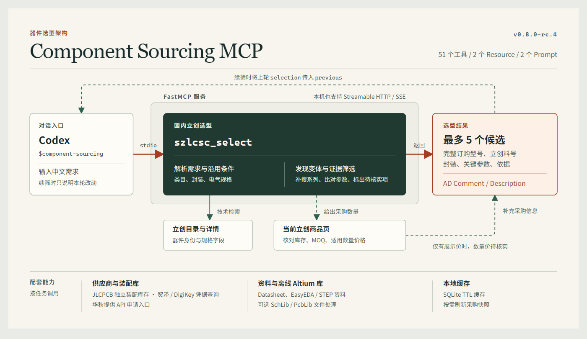

# Component Sourcing MCP

**在 Codex 里用中文查元器件、比较候选，并把选型结果带进 Altium Designer。** 告诉 Codex 需要什么器件、有哪些电气和封装要求，它就能查立创商城并给出最多 5 个候选。每行列出完整订购型号、立创 C 编号、关键参数和来源，以及可直接粘贴到 AD 器件库的 **Comment** 和 **中文 Description**。

[下载 v0.8.0-rc.4 预发布版](https://github.com/zhr1008/component-sourcing-mcp/releases/tag/v0.8.0-rc.4) · [Windows 安装与接入](#windows-安装与接入-codex) · [Agent 与 Skill](#agent-与-skill)

## 在 Codex 里怎么用

1. **先按电路需求找料。** 「找一颗 3.3 V 电压基准，初始精度 ≤0.2%，SOT-23。给我立创料号和 AD 的 Comment、Description。」
2. **只说改哪一项。** 「初始精度放宽到 0.5%。」同一对话继续沿用 3.3 V 和 SOT-23 条件。
3. **有数量再询价。** 「按 100 颗报价。」这时才为候选查当前库存、起订量和适用于该数量的价格。商品页只给展示价时，100 颗的单价和总价会标为待核实。

也可以用已知的完整料号查封装、找 Datasheet，或按系列补查不同后缀与引脚数。投板前，按完整订购型号核对厂家 Datasheet 中的电气条件、引脚与封装尺寸。



## 能查哪些渠道

| 渠道 | 能查什么 | 使用条件 |
| --- | --- | --- |
| **立创商城 SZLCSC** | 中文需求选型、精确料号、封装和参数、公开零售库存和人民币数量报价 | 使用公开数据。部分商品的完整阶梯价需要在商城核对。 |
| **嘉立创 JLCPCB** | 基础库、优选库、扩展库及装配库存 | 装配库存与立创商城零售库存分别核对。 |
| **贸泽 Mouser、DigiKey** | 关键词与料号查询、库存和原币阶梯价 | 各平台需自行申请 API 凭据，接口已通过模拟测试。 |
| **华秋 Huaqiu** | 官方 API 申请渠道 | 适配器待接入。 |

资料工具支持下载 Datasheet、获取 EasyEDA 和 STEP 资产。需要生成、整理或核验 `.SchLib` / `.PcbLib` 时，可按需安装 Altium 扩展。 [供应商申请与配置](docs/supplier-setup.md) · [Altium 库用法](#altium-库与投板核对)

## Windows 安装与接入 Codex

安装 Python 3.12，然后从 Release 的 **Assets** 下载 `component-sourcing-mcp-v0.8.0-rc.4.zip` 并解压。打开解压后含有 `pyproject.toml` 的文件夹，在该文件夹打开 PowerShell 并运行以下命令。基础查料也支持 Python 3.11。

```powershell
py -3.12 -m venv .venv
& '.\.venv\Scripts\python.exe' -m pip install .
& '.\.venv\Scripts\python.exe' -m pip check
```

接着在 Codex 配置文件中添加 `components` 服务，把配置示例里的路径换成刚才解压的文件夹。重新连接后，先试一句「用 components 查立创 C2040 的型号、封装和 Datasheet，只查目录」。 [Codex 配置示例与连通检查](docs/codex-setup-and-validation.md)

## Agent 与 Skill

MCP 服务提供实际查询和库文件工具。**`szlcsc` Skill 负责选择工具、保留选型条件、判断证据并组织结果。** 安装时将整个 `skills/szlcsc/` 目录复制到使用者项目的 `.agents/skills/` 下，确保最终路径为 `.agents/skills/szlcsc/SKILL.md`。新开该项目的 Codex 对话，可用 `$szlcsc` 显式调用。MCP 服务需要单独配置。 [Skill 源文件](skills/szlcsc/SKILL.md) · [Codex Skill 安装位置](https://developers.openai.com/api/reference/cli)

| 任务 | MCP 工具与参数 |
| --- | --- |
| **中文需求选型** | 先调用 `szlcsc_select(request=…)`，通过 `conditions` 补充未识别的硬条件。只改一项时，将上轮 `selection` 原样传给 `previous`。 |
| **补找系列或确认精确型号** | 用 `szlcsc_discover` 补查系列和封装，用 `szlcsc_get_part` 按完整型号或 C 编号确认。纯技术查询传 `include_procurement=false`。检查 `coverage` 和待核实项。 |
| **采购复核** | 明确数量后让 `szlcsc_select` 补充报价，或对既定料号调用 `szlcsc_get_stock` 和 `szlcsc_get_pricing`。区分展示价、适用数量的报价和未知值。 |
| **装配与跨供应商查询** | 嘉立创装配库用 `szlcsc_jlcpcb_search`。跨供应商先看 `component_providers`，再用 `component_search`、`component_get`、`component_offers`。 |
| **下载资料与离线检查 Altium** | 下载走 `szlcsc_download_part` 或 `szlcsc_eda_assets`。查库图元、校验和比对用可选的 `altium-offline-library`，读已保存的工程、原理图和 PCB 用 Skill 自带脚本。 |

选型结果保留各行的 `ad_comment`、`ad_description` 和证据链接。芯片 Comment 使用含订购后缀的完整型号，立创 C 编号单列。参数缺证据时标明具体待核实项。系列查询无结果时说明已查范围。 [完整调用规则](skills/szlcsc/SKILL.md)

## Altium 库与投板核对

装好的 `szlcsc` Skill 可直接引导**离线查库和工程盘点**。读取和核对 `.SchLib` / `.PcbLib` 走独立库文件 MCP，已保存的 `.PrjPcb` / `.SchDoc` / `.PcbDoc` 走 Skill 自带脚本。离线路径无需启动 Altium Designer。 [离线工具接入](docs/altium-offline.md)

基础安装即可返回 AD Comment 和 Description。要直接处理 AD 库文件，需 Python 3.12+，在源码目录为同一环境安装可选扩展。

```powershell
& '.\.venv\Scripts\python.exe' -m pip install '.[altium]'
```

EasyEDA 转 Altium 或合并库还需独立的 `altium-cruncher`。已有库的参数写回默认先预览，实际写回前备份。生成的符号和封装要与厂家文档对照，尤其是 Pin 1、引脚编号、焊盘尺寸和 3D 方位。可选依赖目前存在已知安全公告，处理库文件前请查看说明。 [Windows 转换器安装脚本](scripts/install-altium-cruncher.ps1) · [库操作](skills/szlcsc/SKILL.md) · [依赖安全记录](docs/dependency-security.md) · [本地验收](docs/local-validation.md)

## 开发与贡献

v0.8.0-rc.4 提供 51 个工具、两个 Resource 和两个 Prompt。Python 模块为 `szlcsc_mcp`，CLI 为 `component-sourcing-mcp`，并兼容 `szlcsc-mcp`。客户端示例、传输设置、测试命令及实时验证说明见接入指南。 [Codex 接入与验证](docs/codex-setup-and-validation.md) · [其他客户端配置](mcp.example.json) · [变更记录](CHANGELOG.md) · [贡献指南](CONTRIBUTING.md) · [漏洞报告](SECURITY.md)

本仓库自有代码采用 MIT 许可证。可选的 `altium-monkey` 和 `altium-cruncher` 采用 AGPL-3.0-or-later。Datasheet 与 CAD 资产保留上游权利。本项目为独立社区实现。 [MIT 许可证](LICENSE) · [第三方许可](THIRD_PARTY_NOTICES.md)
